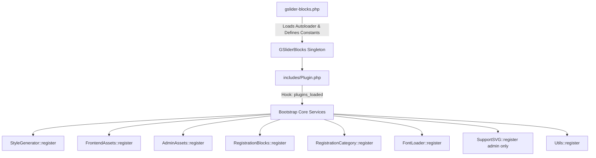

# GSlider PHP Backend Architecture Skill

This skill documents the PHP backend architecture, design patterns, security rules, and service implementations of **GSlider Blocks**.

---

## 🏛️ PHP Architecture & Lifecycle



---

## 📦 Autoloading & Namespaces

- **Root Namespace**: `GSlider\`
- **Autoload Standard**: PSR-4 configured in `composer.json`:
  ```json
  "autoload": {
      "psr-4": {
          "GSlider\\": "includes/"
      }
  }
  ```
- **Namespace Structure**:
  - `GSlider\Plugin` -> `includes/Plugin.php`
  - `GSlider\Assets\*` -> `includes/Assets/`
  - `GSlider\Classes\*` -> `includes/Classes/`
  - `GSlider\Traits\*` -> `includes/Traits/`
  - `GSlider\Utils\*` -> `includes/Utils/`

---

## 🧬 Singleton Pattern & Registrable Services

Every core service class implements `GSlider\Interfaces\Registrable` and uses `GSlider\Traits\SingletonTrait`:

```php
<?php
namespace GSlider\Classes;

use GSlider\Interfaces\Registrable;
use GSlider\Traits\SingletonTrait;

if ( ! defined( 'ABSPATH' ) ) {
    exit;
}

class MyNewService implements Registrable {
    use SingletonTrait;

    // Optional: Only declare if custom init is needed, and MUST be private!
    // private function __construct() { ... }

    public function register(): void {
        add_action( 'init', [ $this, 'on_init' ] );
    }

    public function on_init() {
        // Implementation
    }
}
```

### 🔒 Singleton Encapsulation & Codebase-First Rules
1. **Never Duplicate Trait Methods**: `SingletonTrait` already provides `$instance`, `getInstance()`, `__clone()`, and `__wakeup()`. Never redeclare them in service classes.
2. **Strict Private Constructors**: If any singleton class declares `__construct()`, it MUST be `private function __construct()`. Never leave a constructor `public`.
3. **Inspect First**: Always view existing traits, interfaces, and base classes before editing code to prevent redundant code.

---

## 🔑 Core Backend Services

### 1. `RegistrationBlocks.php`
- Scans `build/blocks/` dynamically for subdirectories containing `block.json`.
- Applies the `gslider_registered_blocks` filter for extensibility.
- Automatically calls `register_block_type()` on each valid block directory.

### 2. `StyleGenerator.php`
- Attaches to the `render_block` filter to harvest `blockStyle` attributes from rendered GSlider blocks.
- On `wp_footer`, compiles, minifies, and writes the CSS to `wp-content/uploads/gslider-blocks/css/gslider-blocks-dynamic-styles-{page_id}.min.css` using `WP_Filesystem`.
- Enqueues the per-page stylesheet with `filemtime()` cache-busting.

### 3. `FontLoader.php`
- Scans rendered block attributes matching the regex `/^(\w+)FontFamily$/i`.
- Collects unique font families and generates an optimized Google Fonts API request containing all necessary font weight variants.
- Enqueues the Google Fonts stylesheet in the footer.

### 4. `SupportSVG.php`
- Whitelists `image/svg+xml` MIME types for media library uploads.
- Sanitizes uploaded SVG XML files, stripping malicious tags (`<script>`, `<iframe>`, `onload=`, etc.) to prevent XSS attacks.
- Fixes media library attachment JS previews for SVGs.

### 5. `AdminAssets.php` & `FrontendAssets.php`
- Enqueues Swiper CSS/JS (`swiper-bundle.min.css`, `swiper-bundle.min.js`) and `fsLightbox.min.js`.
- Localizes global JavaScript object `GSliderBlocksData` (`site_url`, `ajax_url`, `nonce`, `pluginUrl`) for editor access.

---

## 🛡️ Security & Coding Conventions

1. **Direct Access Protection**: Every PHP file must begin with:
   ```php
   if ( ! defined( 'ABSPATH' ) ) {
       exit;
   }
   ```
2. **Strict Sanitization**:
   - `sanitize_text_field( $val )` for generic strings.
   - `sanitize_key( $val )` for identifiers and slugs.
   - `esc_url_raw( $url )` for database URLs.
3. **Strict Escaping**:
   - Output HTML: `esc_html( $val )` or `esc_html__( 'Text', 'gslider-blocks' )`.
   - HTML Attributes: `esc_attr( $val )` or `esc_attr__( 'Text', 'gslider-blocks' )`.
   - URLs: `esc_url( $url )`.
4. **Filesystem Operations**:
   - Never use direct `file_put_contents` or `mkdir`. Always use WordPress filesystem abstraction (`WP_Filesystem` / `$wp_filesystem->put_contents`).
