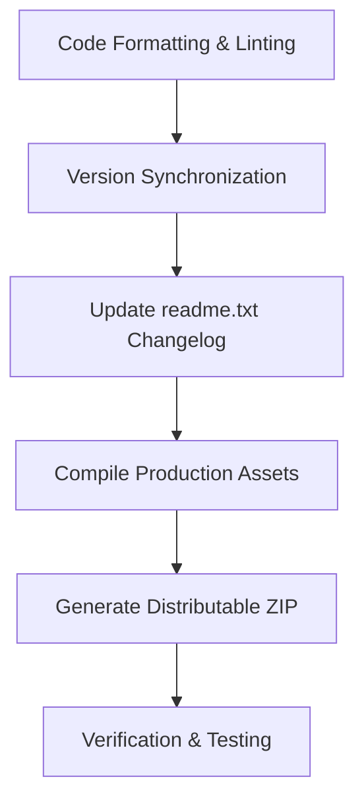

# GSlider QA, Build & Release Skill

This skill documents the complete Quality Assurance (QA), testing, code formatting, version synchronization, and release packaging workflow for **GSlider Blocks**.

---

## 📋 Release Preparation Checklist

Before releasing a new version or packaging the plugin zip, execute the following steps in order:



---

## 1. Code Formatting & Linting

Run the WordPress coding standard tools before committing:

```bash
# Format JS and SCSS/CSS according to WordPress standards
npm run format

# Run ESLint for JavaScript files
npm run lint:js

# Run Stylelint for SCSS/CSS files
npm run lint:css
```

---

## 2. Version Synchronization Matrix

When releasing a new version (e.g., `1.1.9`), the version string MUST be updated in all of the following locations:

| File | Target Line / Constant |
| :--- | :--- |
| **`gslider-blocks.php`** | Plugin Header: `Version: 1.1.9`<br>Constant: `define( 'GSLIDER_VERSION', '1.1.9' );` |
| **`package.json`** | `"version": "1.1.9"` |
| **`readme.txt`** | Header: `Stable tag: 1.1.9`<br>Changelog section: `== Changelog ==` |
| **`README.md`** | Version badge: `Version-1.1.9-orange.svg` |
| **`src/blocks/*/block.json`** | `"version": "1.1.9"` in each block's metadata |

---

## 3. Production Asset Compilation

Compile both Gutenberg block bundles and admin stylesheets in production mode:

```bash
# Compile Gutenberg blocks production bundle
npm run build:production

# Compile admin SCSS production bundle
npm run admin:build
```

---

## 4. Distributable ZIP Generation

Generate the clean distributable zip file using the custom archiver script:

```bash
npm run zip
```
- This script uses `webpack.zip.js` to create `gslider-blocks.zip` in the root directory.
- It automatically excludes `node_modules`, `.git`, `.agents`, `src`, `admin/scss`, and dev config files.

---

## 5. WordPress.org Compliance Verification

Verify that all changes meet WordPress.org repository standards:
- [x] All user-facing strings use `__( '...', 'gslider-blocks' )` or `esc_html__( '...', 'gslider-blocks' )`.
- [x] All PHP superglobals (`$_POST`, `$_GET`, `$_REQUEST`) are unslashed and sanitized (`sanitize_text_field`, `sanitize_key`, `absint`).
- [x] Output values in PHP are escaped (`esc_html`, `esc_attr`, `esc_url`).
- [x] Nonce verification is present on all AJAX and REST endpoints.
- [x] Dynamic styles use `StyleGenerator.php` with `WP_Filesystem`.
- [x] No jQuery dependency; frontend relies strictly on vanilla JavaScript and Swiper bundle.
