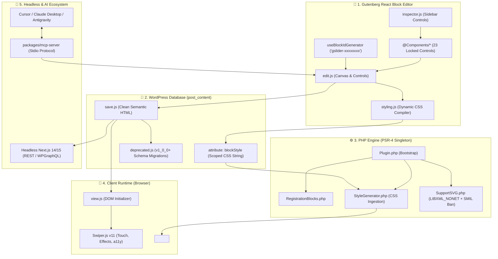

<p align="center">
  
</p>

<h1 align="center">GSlider Blocks</h1>

<p align="center">
  <strong>🎠 The Ultimate Gutenberg Carousel Collection</strong><br>
  High-Performance, React & Swiper.js Powered Slider Blocks for Modern WordPress & Headless Stacks
</p>

<p align="center">
  <a href="https://github.com/noruzzamans/gslider-blocks/actions/workflows/ci.yml">
    
  </a>
  <a href="https://wordpress.org/plugins/gslider-blocks/">
    
  </a>
  <a href="https://wordpress.org/plugins/gslider-blocks/">
    
  </a>
  <a href="https://wordpress.org/plugins/gslider-blocks/">
    
  </a>
  <a href="https://php.net/">
    
  </a>
  <a href="http://www.gnu.org/licenses/gpl-2.0.html">
    
  </a>
  <a href="#-ai-assistant-integration-model-context-protocol---mcp">
    
  </a>
  <a href="https://wordpress.org/plugins/gslider-blocks/">
    
  </a>
</p>

<p align="center">
  <a href="#-about--value-proposition">About</a> •
  <a href="#-system-architecture">Architecture</a> •
  <a href="#-available-blocks">Blocks</a> •
  <a href="#-ai-assistant-integration-model-context-protocol---mcp">MCP AI Guide</a> •
  <a href="#-headless-wordpress--nextjs-showcase">Headless</a> •
  <a href="#-local-environment-setup">Setup</a> •
  <a href="#-contributing--governance">Contributing</a>
</p>

---

## 📖 About & Value Proposition

**GSlider Blocks** is an enterprise-grade Gutenberg carousel library powering sliders on **2,000+ active WordPress websites**. Built with modern React, PSR-4 PHP architecture, and Swiper 11, it delivers fluid hardware-accelerated animations, zero block invalidations, and native Headless/AI support without any jQuery dependencies.

### Why GSlider Blocks?

| Feature | GSlider Blocks | Typical Slider Plugins |
| :--- | :---: | :---: |
| **Gutenberg Native** | ✅ Direct block canvas editing | ❌ Shortcodes or detached builders |
| **Performance & Weight** | ✅ Hardware-accelerated Swiper 11, Zero jQuery | ❌ Heavy jQuery, bloated CSS bundles |
| **Dynamic CSS Pipeline** | ✅ Server-rendered scoped CSS, 0 inline styles | ❌ Polluted inline `style=""` attributes |
| **Responsive Architecture** | ✅ Dedicated 3-device controls (Desktop, Tablet, Mobile) | ⚠️ Generic breakpoint guessing |
| **Local AI Integration** | ✅ Model Context Protocol (MCP) server ($0 cloud cost) | ❌ No AI schema support |
| **Headless Ready** | ✅ Semantic REST API / WPGraphQL JSON serialization | ❌ Shortcode regex parsing needed |
| **Code Stability** | ✅ Backwards-compatible `deprecated.js` migrations | ❌ "Block invalidation" white screens on updates |

---

## 🏗️ System Architecture

GSlider Blocks follows a strict 5-tier architecture connecting the Gutenberg Editor, Dynamic Style Engine, Frontend Runtime, Local AI Engine, and Headless APIs:



> [!NOTE]
> For deep-dive architectural rules, review our comprehensive **[ARCHITECTURE.md](ARCHITECTURE.md)** guide.

---

## 📦 Available Blocks

| # | Block | Description | Status |
| :-: | :--- | :--- | :-: |
| 1 | 🎯 **Base Slider** | High-impact hero sliders with Title, Subtitle, Description & CTA buttons | ✅ Production |
| 2 | 📝 **Flexi Content** | Full creative freedom: nest ANY Gutenberg block inside responsive slides | ✅ Production |
| 3 | 🏢 **Logo Carousel** | Partner/client showcases with grayscale-to-color hover and ticker mode | ✅ Production |
| 4 | 🖼️ **Image Slider** | Gallery sliders with lightbox, captions, and responsive thumbnails | ✅ Production |
| 5 | ⭐ **Testimonial Carousel** | Customer reviews with star ratings, avatars, and verified badges | ✅ Production |
| 6 | 👥 **Team Carousel** | Member profiles with bio, social links, and modal bio triggers | 📋 Roadmap |
| 7 | 🎥 **Video Carousel** | Self-hosted, YouTube, and Vimeo responsive video carousels | 📋 Roadmap |
| 8 | 📊 **Stats Carousel** | Animated milestone counters and metric sliders | 📋 Roadmap |
| 9 | 🏆 **Awards Carousel** | Certification badges and industry recognition carousels | 📋 Roadmap |
| 10 | 📰 **Post Carousel** | Dynamic WordPress posts & custom post type query slider | 📋 Roadmap |

---

## 🤖 AI Assistant Integration (Model Context Protocol - MCP)

GSlider Blocks ships with an official local **Model Context Protocol (MCP)** server located in `packages/mcp-server`. It empowers AI assistants and agentic IDEs (Cursor, Claude Desktop, Windsurf, Antigravity, etc.) to inspect, scaffold, and generate WordPress slider blocks directly from natural language or Figma designs with **$0 cloud cost**.

### 🧠 Model-Agnostic Architecture (OpenAI, Claude, Gemini)

The GSlider MCP Server operates over standard input/output (`stdio`) and is completely **model-agnostic**. You can connect it to any leading foundation model:
- **OpenAI Ecosystem:** GPT-4o, o1, o3-mini, ChatGPT, and OpenAI-compatible developer agents.
- **Anthropic Ecosystem:** Claude 3.7 Sonnet, Claude 3.5 Haiku, Claude Desktop.
- **Google Ecosystem:** Gemini 2.0 Pro, Gemini 2.0 Flash via agentic environments.
- **Open Weights:** DeepSeek-R1, Llama 3.3 via Ollama or local inference runtimes.

---

### 1-Click Client Configurations

#### 1. Cursor IDE (`.cursor/mcp.json`)
*Compatible with OpenAI GPT-4o, Claude 3.7, and Gemini inside Cursor:*

```json
{
  "mcpServers": {
    "gslider": {
      "command": "node",
      "args": [
        "./packages/mcp-server/dist/index.js"
      ]
    }
  }
}
```

#### 2. Claude Desktop (`claude_desktop_config.json`)
- **macOS:** `~/Library/Application Support/Claude/claude_desktop_config.json`  
- **Windows:** `%APPDATA%\Claude\claude_desktop_config.json`

```json
{
  "mcpServers": {
    "gslider": {
      "command": "node",
      "args": [
        "/absolute/path/to/gslider-blocks/packages/mcp-server/dist/index.js"
      ]
    }
  }
}
```

#### 3. Windsurf IDE (`~/.codeium/windsurf/mcp_config.json`)
*Compatible with Windsurf Cascade and OpenAI models:*

```json
{
  "mcpServers": {
    "gslider": {
      "command": "node",
      "args": [
        "/absolute/path/to/gslider-blocks/packages/mcp-server/dist/index.js"
      ]
    }
  }
}
```

#### 4. VS Code (Cline / Roo Code / Copilot Agent)
*Compatible with OpenAI API keys (GPT-4o, o3-mini), Anthropic, and local models:*

```json
{
  "mcpServers": {
    "gslider": {
      "command": "node",
      "args": [
        "/absolute/path/to/gslider-blocks/packages/mcp-server/dist/index.js"
      ]
    }
  }
}
```

#### 5. OpenAI SDK / Custom Agent Integration (Node.js)

Connect the GSlider MCP server directly to OpenAI's Function Calling API:

```javascript
import { Client } from "@modelcontextprotocol/sdk/client/index.js";
import { StdioClientTransport } from "@modelcontextprotocol/sdk/client/stdio.js";
import OpenAI from "openai";

const transport = new StdioClientTransport({
  command: "node",
  args: ["./packages/mcp-server/dist/index.js"]
});
const mcp = new Client({ name: "openai-gslider-agent", version: "1.0.0" }, { capabilities: {} });
await mcp.connect(transport);

// Map MCP tools into OpenAI Function Calling format
const { tools } = await mcp.listTools();
const openai = new OpenAI();
const completion = await openai.chat.completions.create({
  model: "gpt-4o",
  messages: [{ role: "user", content: "Inspect available GSlider block schemas" }],
  tools: tools.map(t => ({
    type: "function",
    function: { name: t.name, description: t.description, parameters: t.inputSchema }
  }))
});
```

### Available MCP Tools

| Tool | Purpose | Status |
| :--- | :--- | :---: |
| `gslider_ping` | Verifies MCP daemon connection and plugin version | ✅ Available |
| `list_gslider_blocks` | Returns all registered blocks and supported visual controls | ✅ Available |
| `get_block_schema` | Returns exact attribute schemas and slide data structures | ✅ Available |
| `generate_slider_block` | Generates validated Gutenberg markup with automated CSS | 🔜 In Progress |

---

## 🌐 Headless WordPress & Next.js Showcase

GSlider Blocks outputs clean, standards-compliant semantic HTML and exposes complete block attribute trees through the core WordPress REST API (`/wp/v2/pages/<id>?context=edit`). 

### Consuming GSlider in Next.js 14/15 (App Router)

```tsx
// app/components/GSliderRenderer.tsx
import React from 'react';
import { Swiper, SwiperSlide } from 'swiper/react';
import { Autoplay, Navigation, Pagination } from 'swiper/modules';
import 'swiper/css';
import 'swiper/css/navigation';
import 'swiper/css/pagination';

interface GSliderBlockProps {
  block: {
    blockName: string;
    attrs: {
      blockId: string;
      slidesPerView?: { Desktop?: number; Tablet?: number; Mobile?: number };
      autoplay?: boolean;
      autoplayDelay?: number;
      showNavigation?: { Desktop?: boolean };
      showPagination?: { Desktop?: boolean };
      slides?: Array<{ id: string; title: string; image: string }>;
    };
  };
}

export default function GSliderRenderer({ block }: GSliderBlockProps) {
  if (block.blockName !== 'gslider/image-slider') return null;

  const { attrs } = block;

  return (
    <div className={`gslider-wrapper ${attrs.blockId}`}>
      <Swiper
        modules={[Autoplay, Navigation, Pagination]}
        spaceBetween={20}
        slidesPerView={attrs.slidesPerView?.Mobile || 1}
        breakpoints={{
          768: { slidesPerView: attrs.slidesPerView?.Tablet || 2 },
          1024: { slidesPerView: attrs.slidesPerView?.Desktop || 3 },
        }}
        autoplay={attrs.autoplay ? { delay: attrs.autoplayDelay || 3000 } : false}
        navigation={Boolean(attrs.showNavigation?.Desktop)}
        pagination={attrs.showPagination?.Desktop ? { clickable: true } : false}
      >
        {attrs.slides?.map((slide) => (
          <SwiperSlide key={slide.id}>
            
            <h3 className="text-lg font-bold mt-2">{slide.title}</h3>
          </SwiperSlide>
        ))}
      </Swiper>
    </div>
  );
}
```

---

## 💻 Local Environment Setup

We support both GUI-based workflows (LocalWP) and zero-config containerized workflows (Docker via `@wordpress/env`):

### Prerequisites

| Requirement | Minimum Version | Recommended |
| :--- | :--- | :--- |
| **Node.js** | `>= 18.0.0` | `20.x LTS` |
| **npm** | `>= 9.0.0` | `10.x` |
| **PHP** | `>= 7.4.0` | `8.2 / 8.3` |
| **WordPress** | `>= 5.9.0` | `6.7+` |

---

### Option A: LocalWP (Recommended GUI Workflow)

1. Open [Local](https://localwp.com/) and create a new WordPress site.
2. Clone this repository directly into the site's plugin directory:
   ```bash
   cd ~/Local\ Sites/<site-name>/app/public/wp-content/plugins/
   git clone https://github.com/noruzzamans/gslider-blocks.git
   cd gslider-blocks
   ```
3. Install dependencies and start development watch mode:
   ```bash
   npm install
   npm run start
   ```
4. Activate **GSlider Blocks** from WP Admin → Plugins.

---

### Option B: Docker via `@wordpress/env` (Zero-Config CLI)

If you have Docker Desktop installed, spin up a complete WordPress instance with GSlider Blocks pre-mounted in one command:

```bash
# 1. Clone repository
git clone https://github.com/noruzzamans/gslider-blocks.git
cd gslider-blocks

# 2. Install dependencies
npm install

# 3. Start WordPress in Docker (Port 8888)
npx @wordpress/env start
```

- **Frontend:** [http://localhost:8888](http://localhost:8888)
- **WP Admin:** [http://localhost:8888/wp-admin](http://localhost:8888/wp-admin) (`Username: admin`, `Password: password`)
- **Stop Environment:** `npx @wordpress/env stop`

---

## ⚡ Essential NPM Scripts

| Command | Purpose |
| :--- | :--- |
| `npm run start` | Starts watch mode for Gutenberg blocks development (`wp-scripts start`) |
| `npm run build` | Compiles production assets into `build/` |
| `npm run lint:js` | Runs ESLint across all JavaScript files |
| `npm run lint:css` | Runs Stylelint across all SCSS/CSS stylesheets |
| `npm run admin` | Starts watch mode for admin styles |
| `npm run admin:build` | Compiles admin stylesheets for production |
| `npm run mcp:build` | Builds the TypeScript MCP server in `packages/mcp-server` |
| `npm run zip` | Generates a clean, production-ready WordPress.org distributable zip |

---

## 🛡️ Testing & Code Quality Matrix

Every pull request runs automated GitHub Actions CI:
- **Build Verification:** Compiles full Gutenberg and admin bundles.
- **PHP Matrix Testing:** Automated tests pass on **7 PHP versions**: `PHP 7.4`, `8.0`, `8.1`, `8.2`, `8.3`, `8.4`, and `8.5`.
- **MCP Drift Verification:** Confirms `packages/mcp-server` builds cleanly without TypeScript discrepancies.
- **Component Lock Guard:** Automatically checks PR diffs to ensure `src/components/` remains protected.

---

## 🤝 Contributing & Governance

Contributions from both human engineers and AI assistants are welcome! Please read our contributing documentation before starting:

- 📖 **[CONTRIBUTING.md](CONTRIBUTING.md)**: Forking, branching, PR title conventions, and AI contribution policy.
- 🏗️ **[ARCHITECTURE.md](ARCHITECTURE.md)**: Engineering principles, patterns, and pre-flight developer checklist.
- 📜 **[CODE_OF_CONDUCT.md](CODE_OF_CONDUCT.md)**: Contributor Covenant v2.1.
- 🛡️ **[SECURITY.md](SECURITY.md)**: Vulnerability disclosure policy and security protections.

> [!IMPORTANT]
> **Issue-First Policy:** GSlider Blocks strictly requires all pull requests to resolve an approved [GitHub Issue](https://github.com/noruzzamans/gslider-blocks/issues) using `Closes #<issue_number>`. Unsolicited PRs submitted without an issue will be closed.

> [!CAUTION]
> **Component Lock Policy:** `src/components/` contains 23 core UI controls and is strictly locked to `@noruzzamans`. PRs modifying `src/components/` without maintainer authorization will be automatically rejected.

---

## 📄 License

GSlider Blocks is open-source software licensed under the **GNU General Public License v2.0 or later (GPL-2.0-or-later)**.

```
GSlider Blocks - Gutenberg Carousel Collection for WordPress
Copyright (C) 2025-2026 Noruzzaman

This program is free software; you can redistribute it and/or modify
it under the terms of the GNU General Public License as published by
the Free Software Foundation; either version 2 of the License, or
(at your option) any later version.
```

---

## 👨‍💻 Maintainer & Credits

<p align="center">
  
</p>

<p align="center">
  <strong>Noruzzaman</strong><br>
  WordPress Core & Gutenberg Engineer | Open Source Maintainer
</p>

<p align="center">
  <a href="https://github.com/noruzzamans">
    
  </a>
  <a href="https://linkedin.com/in/noruzzaman">
    
  </a>
  <a href="https://wordpress.org/plugins/gslider-blocks/">
    
  </a>
</p>

### Special Credits
- [Swiper.js](https://swiperjs.com/) — The modern mobile touch slider library.
- [WordPress Gutenberg](https://github.com/WordPress/gutenberg) — Block editor framework.
- [React](https://reactjs.org/) — Declarative UI component engine.
- [Appsero](https://appsero.com/) — Telemetry and analytics.

---

<p align="center">
  Made with ❤️ for the global WordPress Community
</p>
