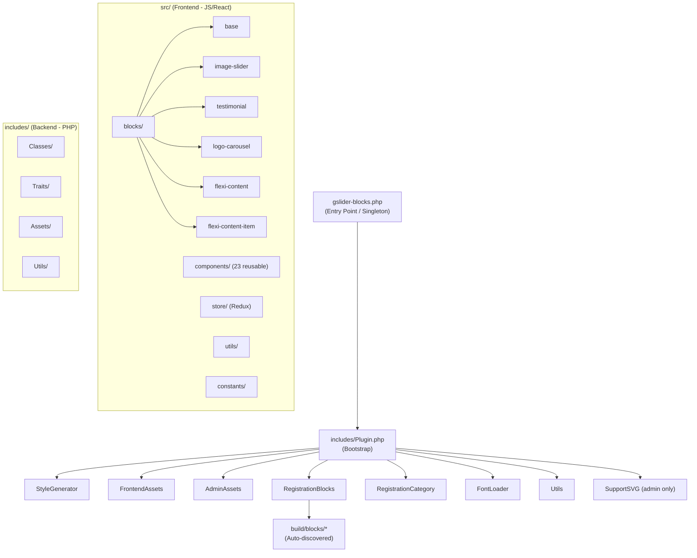

# 🏗️ GSlider Blocks — Architecture Review

> Date: March 1, 2026
> Plugin Version: 1.1.6

---

## Overall Architecture Diagram



---

## ✅ ভালো যা আছে (Strengths)

### 1. PHP Backend — Solid Foundation
- ✅ **Namespace ব্যবহার** — `GSlider\Classes`, `GSlider\Traits`, `GSlider\Assets` — proper PSR-4 style
- ✅ **Singleton Pattern** — `SingletonTrait` দিয়ে centralized
- ✅ **Service Registration Pattern** — `Plugin.php` তে সব service `register()` method দিয়ে hook করে — clean
- ✅ **Auto Block Discovery** — `RegistrationBlocks` dynamically `build/blocks/` scan করে — new block add করলে manually register করা লাগে না
- ✅ **Dynamic CSS Generation** — `StyleGenerator` per-page CSS file generate করে, minify করে, cache করে — good performance approach
- ✅ **Security basics** — `ABSPATH` check, `sanitize_file_name()`, `sanitize_key()` ব্যবহার

### 2. Frontend JS — Good Structure
- ✅ **Component Library** — 23টা reusable component (color-control, spacing-control, typography-control etc.) — excellent!
- ✅ **Redux Store** — centralized state management আছে
- ✅ **Block Structure** — প্রতিটা block-এ consistent file structure (index.js, edit.js, save.js, inspector.js, attributes.js, styling.js, view.js)
- ✅ **Preset System** — multiple design presets support
- ✅ **Drag & Drop** — `@dnd-kit` দিয়ে reordering — modern approach
- ✅ **Build System** — `@wordpress/scripts` + custom webpack configs — standard WordPress way

### 3. Good Practices
- ✅ **Composer + npm** — proper dependency management
- ✅ **Separate admin/frontend assets**
- ✅ **i18n support** — text domain loaded
- ✅ **GPL-2.0 license** — WordPress compatible
- ✅ **AUDIT_REPORT.md** + **WORDPRESS_SECURITY_STANDARDS.md** — security awareness

---

## ⚠️ উন্নতির জায়গা (Areas for Improvement)

### 🔴 Critical Issues

#### 1. Monster Files — Extreme File Sizes
এটা সবচেয়ে বড় architectural problem:

| File | Size | Problem |
|---|---|---|
| `testimonial/inspector.js` | **204 KB** | ১টা file-এ সব inspector controls |
| `base/inspector.js` | **179 KB** | Same issue |
| `image-slider/inspector.js` | **150 KB** | Same issue |
| `testimonial/styling.js` | **113 KB** | ১টা file-এ সব CSS generation |
| `base/deprecated.js` | **130 KB** | Huge deprecation file |
| `testimonial/attributes.js` | **90 KB** | ১টা file-এ সব attributes |

**কেন সমস্যা:**
- কোনো developer এত বড় file maintain করতে পারবে না
- AI tools ও এত বড় file ভালোমত process করতে পারে না
- Bug খুঁজে পাওয়া কঠিন
- Multiple developers একসাথে কাজ করতে গেলে merge conflict

**সমাধান:**
```
inspector.js (204KB) → inspector/
  ├── index.js (main export)
  ├── GeneralPanel.js
  ├── StylePanel.js
  ├── TypographyPanel.js
  ├── SpacingPanel.js
  ├── AnimationPanel.js
  └── AdvancedPanel.js
```

#### 2. Double Initialization Issue
```php
// gslider-blocks.php এ ২ বার instance তৈরী হচ্ছে:
GSliderBlocks::getInstance();  // Line 76
GSliderBlocks();               // Line 89 (আবার call করে)
```
একটা redundant — remove করা উচিত।

#### 3. Constructor Visibility Mismatch
```php
// gslider-blocks.php → public __construct()
// StyleGenerator.php → private __construct()
```
Singleton pattern-এ constructor **private** হওয়া উচিত সব জায়গায়।

---

### 🟡 Medium Issues

#### 4. No Interface
> Currently, service classes (StyleGenerator, AssetManager, etc.) are directly initialized. Adding a `Registrable` interface ensures a standard `register()` method across all services.
```php
interface Registrable {
    public function register(): void;
}
```

#### 5. Code Duplication Across Blocks
- `base`, `image-slider`, `testimonial` — সবার file structure almost identical
- Common logic (slider initialization, responsive handling) repeated across blocks
- **সমাধান:** Base block class/mixin তৈরী করা

#### 6. No Error Boundary / Fallback
- Block-এ error হলে পুরো editor crash করতে পারে
- React Error Boundary ব্যবহার করা উচিত

#### 7. Constants File Single Responsibility
- `constants/index.js` (9.7 KB) — সব constants একটা file-এ
- Block-specific constants আলাদা করা উচিত

---

### 🟢 Minor / Nice-to-Have

#### 8. No Automated Tests
- কোনো PHP unit test নেই
- কোনো JS test নেই
- E2E test নেই
- এটা future-proofing এর জন্য critical

#### 9. No CI/CD Pipeline
- `.github/workflows/` নেই
- Build, lint, test automate করা দরকার

#### 10. Missing TypeScript
- সব JS file plain JavaScript
- TypeScript ব্যবহার করলে type safety পাওয়া যাবে
- বড় file গুলোতে bugs কমবে

---

## 🎯 Priority Action Items

| Priority | Action | Impact |
|---|---|---|
| 🔴 P0 | Inspector.js files split করুন | Maintainability, DX |
| 🔴 P0 | Styling.js files split করুন | Same |
| 🔴 P0 | Attributes.js files split করুন | Same |
| 🟡 P1 | Double initialization fix | Clean code |
| 🟡 P1 | Interface add করুন | Architecture |
| 🟡 P1 | Cross-block code duplication remove | DRY |
| � P2 | Basic unit tests add করুন | Quality |
| 🟢 P2 | CI/CD setup | Automation |
| 🟢 P3 | TypeScript migration | Type safety |

---

## 📊 Architecture Score

| Category | Score | Notes |
|---|---|---|
| File Organization | ⭐⭐⭐ | Good top-level, but monster files inside blocks |
| PHP Backend | ⭐⭐⭐⭐ | Solid — namespace, singleton, services |
| JS Frontend | ⭐⭐⭐ | Good components, but inspector/styling too large |
| Reusability | ⭐⭐⭐⭐ | 23 reusable components — excellent |
| Security | ⭐⭐⭐⭐ | Good basics, has audit report |
| Testing | ⭐ | No tests at all |
| Build System | ⭐⭐⭐⭐ | Standard wp-scripts + custom webpack |
| Scalability | ⭐⭐ | Monster files will block scaling |

**Overall: ⭐⭐⭐ (3/5) — Good foundation, needs file splitting and tests**

---

## 💡 Final Verdict

আপনার plugin-এর **foundation ভালো** — PHP backend architecture, component library, build system সব ঠিক আছে। 

**সবচেয়ে বড় সমস্যা একটাই: Monster files।** ১৫০-২০০ KB inspector files কোনো মানুষ বা AI efficiently handle করতে পারবে না। এটা split করলে আপনার plugin-এর maintainability dramatically improve হবে।

দ্বিতীয় priority হলো **testing** — একটাও test নেই, এটা production plugin-এর জন্য risky।
