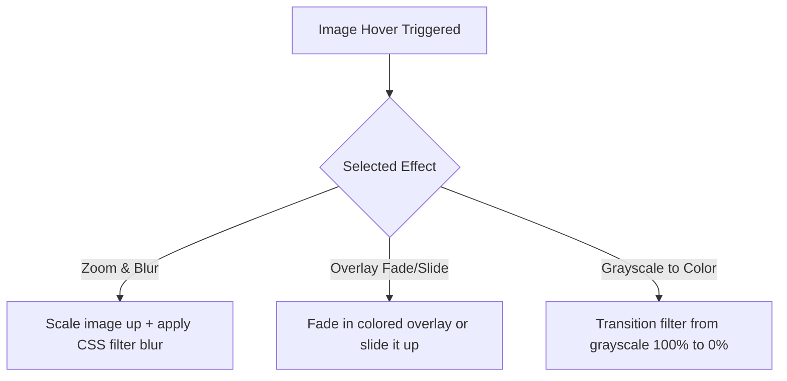

# Premium Post Carousel: Animations & Improvements Roadmap

This document outlines the proposed premium animations, micro-interactions, layout stabilization techniques, and metadata enhancements for the **Post Carousel** block to achieve a world-class, professional standard.

---

## 1. Card Hover & Lift Animations

Adding hover interactions to the entire post card makes the carousel feel highly interactive and premium.

### Proposed Styles
| Animation Name | Description | CSS Transform & Transition |
| :--- | :--- | :--- |
| **Float Up (Lift)** | The card shifts upwards slightly on hover while dropping a deeper, softer box shadow. | `transform: translateY(-6px); box-shadow: 0 12px 24px rgba(0,0,0,0.08);` |
| **Zoom In** | The entire card scales up slightly for a subtle focus effect. | `transform: scale(1.02);` |
| **Border Glow / Outline Draw** | A smooth transition changes the border color or adds a subtle border glow. | `border-color: var(--accent-color); box-shadow: 0 0 12px rgba(var(--accent-color-rgb), 0.2);` |

### Technical Approach (Safe Implementation)
- **Attribute:** `cardHoverAnimation` (type: `string`, default: `"none"`).
- **CSS Class:** Dynamically append `.gslider-hover-anim-${cardHoverAnimation}` to `.gslider-post-carousel-card`.
- **Backward Compatibility:** Default is `"none"`, ensuring absolutely no layout or style shifts for existing blocks.

---

## 2. Advanced Image Hover Effects

We can expand the hover effects of the featured image to offer modern magazine layouts.



### Proposed Effects
- **Zoom & Blur:** The image scales up (`scale(1.08)`) and applies a subtle CSS blur filter (`blur(1px)`).
- **Overlay Slide-In:** An overlay background element transitions into view (either sliding up from the bottom, sliding in from the left, or zooming in from the center).
- **Grayscale to Color:** Images are default black-and-white (`filter: grayscale(1);`) and transition smoothly to full color on hover.

---

## 3. Category Badges Overlay on Image

Modern blogs and news sites display category tags directly on top of the featured image as beautiful pill-shaped badges instead of inside the vertical text flow.

```
+-----------------------------------+
|  [ Category Badge ]               |
|                                   |
|          Featured Image           |
|                                   |
+-----------------------------------+
| Post Title                        |
| Post Excerpt ...                  |
+-----------------------------------+
```

### Technical Approach
- **Attribute:** `categoriesPosition` (options: `"flow"` / `"overlay"`, default: `"flow"`).
- **Attribute:** `categoriesOverlayPosition` (options: `"top-left"`, `"top-right"`, `"bottom-left"`, `"bottom-right"`, default: `"top-left"`).
- **HTML DOM:** We keep the categories markup exactly where it is.
- **CSS Solution:** When `categoriesPosition === 'overlay'`, we target:
  ```css
  .gslider-post-carousel-card.categories-overlay-active {
      position: relative;
  }
  .gslider-post-carousel-card.categories-overlay-active .gslider-post-carousel-categories {
      position: absolute;
      z-index: 5;
      top: 12px;
      left: 12px;
      /* Styled as pills: padding, background, border-radius */
  }
  ```
- **Backward Compatibility:** Because the default is `"flow"`, all existing blocks remain unaffected.

---

## 4. Title & Excerpt Word Truncation

A key issue in standard grid/carousel layouts is unequal heights caused by uneven text content. Truncating text dynamically guarantees layout stability.

### Proposed Control
- **Title Word Limit:** `postTitleLimit` (type: `number`, default: `0` [no limit]).
- **Excerpt Word Limit:** `postExcerptLimit` (type: `number`, default: `20`).

### Technical Implementation (PHP & JS Truncation)
In both [edit.js](file:///c:/Users/Rubel%20Ahmed/Local%20Sites/test/app/public/wp-content/plugins/gslider-blocks/src/blocks/post-carousel/edit.js) and [render.php](file:///c:/Users/Rubel%20Ahmed/Local%20Sites/test/app/public/wp-content/plugins/gslider-blocks/src/blocks/post-carousel/render.php):
- **PHP:**
  ```php
  $title = get_the_title();
  if ( $title_limit > 0 ) {
      $title = wp_trim_words( $title, $title_limit, '...' );
  }
  ```
- **Javascript (Editor):**
  ```javascript
  const trimWords = (text, limit) => {
      if (!text || limit <= 0) return text;
      const words = text.split(/\s+/);
      if (words.length <= limit) return text;
      return words.slice(0, limit).join(' ') + '...';
  };
  ```

---

## 5. Rich Meta Details & Separators

We can offer richer metadata and options to control separators between items.

```
[Icon] John Doe   |   [Icon] May 30, 2026   |   [Icon] 3 Min Read
```

### Proposed Improvements
- **Meta Separator Type:** Allow choosing a separator between meta fields (e.g., `Dot (·)`, `Slash (/)`, `Pipe (|)`, or `None`).
- **Author Avatar:** Add a toggle `showAuthorAvatar` to display the WP Gravatar of the author next to their name instead of the SVG icon.
- **Estimated Read Time:** Add a toggle `showReadTime` to calculate reading time dynamically (e.g., based on average 200 words-per-minute read speed).
  - **PHP:**
    ```php
    $word_count = str_word_count( strip_tags( get_post_field( 'post_content', $post_id ) ) );
    $read_time = ceil( $word_count / 200 );
    echo $read_time . ' ' . __( 'Min Read', 'gslider-blocks' );
    ```

---

## 6. Equal Height Card Footer Alignment

Even with limits, cards may differ slightly in size. Ensuring the footer (like the Read More button or Meta) is always aligned to the bottom creates a cohesive design.

### CSS Flexbox alignment
When "Equal Height" is active, we apply a layout where the article is a full-height flex column and the footer element gets `margin-top: auto`.
```css
.gslider-post-carousel-card {
    display: flex;
    flex-direction: column;
    height: 100%;
}
.gslider-post-carousel-card > :last-child {
    margin-top: auto; /* Pushes the last item to the very bottom */
}
```
This is already partly styled in the SCSS, but we can make it fully robust by ensuring that the last child wrapper expands properly depending on active components.
